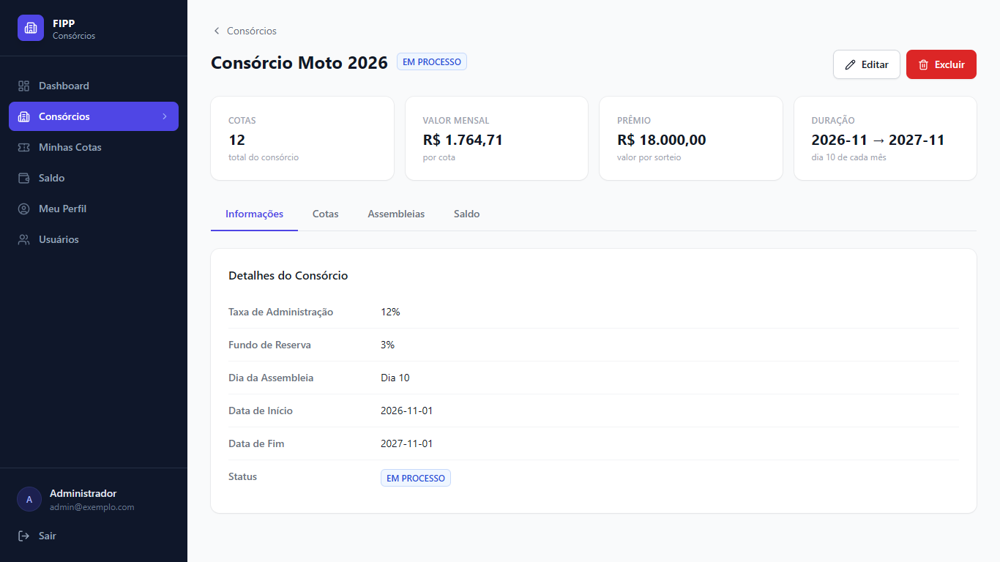
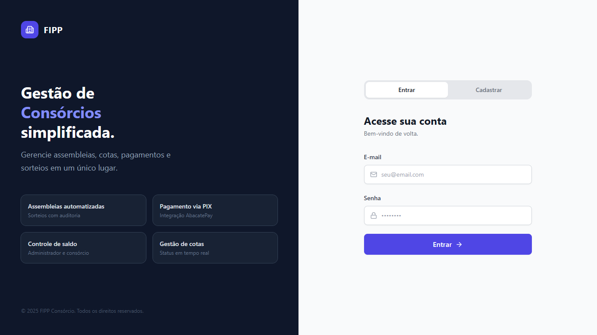
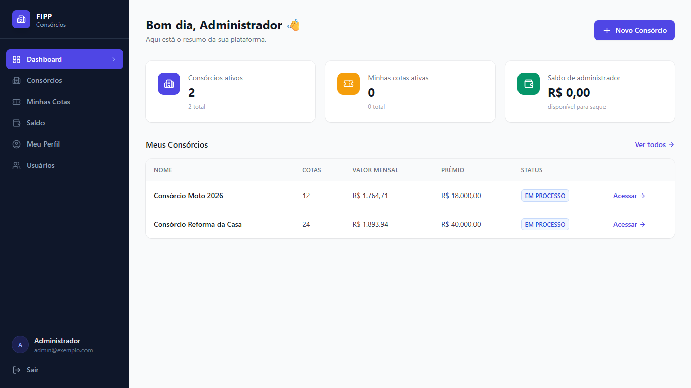
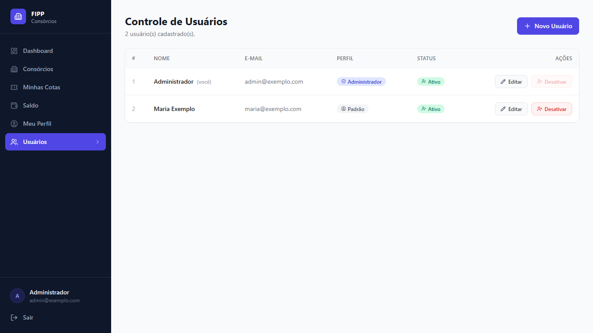
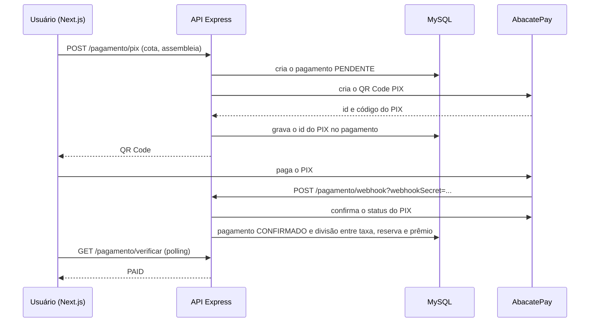

# FIPP Consórcio

> Plataforma de consórcios com cotas, assembleias com sorteio, controle de saldo e pagamento das parcelas por PIX (AbacatePay).

**EN:** Consortium management platform (a Brazilian group-savings scheme): users join groups by buying
shares, pay monthly installments via PIX through the AbacatePay API, and a monthly assembly draws a
winning share. REST API in Node.js/Express + MySQL, front-end in Next.js 14 + Tailwind CSS.



## Sobre

Trabalho da disciplina de Programação Fullstack II do curso de Análise e Desenvolvimento de Sistemas
da FIPP/Unoeste (2026), entregue pelo GitHub Classroom.
<!-- TODO: confirmar com o Thiago o nome da disciplina e se o professor autorizou a publicação -->

Um consórcio reúne pessoas que pagam parcelas mensais. Em cada assembleia, uma cota que ainda não foi
contemplada é sorteada e recebe o valor do prêmio. Cada parcela paga é dividida entre a taxa de
administração, o fundo de reserva e o fundo do prêmio.

## Funcionalidades

- **Usuários:** cadastro público, login com JWT, perfil e administração de usuários (perfis
  `ADMINISTRADOR` e `PADRAO`).
- **Consórcios:** cadastro com quantidade de cotas, valor do prêmio, taxa de administração, fundo de
  reserva, dia da assembleia e data de início. O valor da parcela e a data de fim são calculados.
- **Cotas:** o usuário entra em um consórcio comprando uma cota e acompanha as próprias cotas.
- **Pagamentos:** geração de QR Code PIX pelo AbacatePay, verificação do status e confirmação por
  webhook. Ao confirmar, o valor é dividido entre taxa de administração, fundo de reserva e prêmio.
- **Assembleias:** sorteio de uma cota não contemplada quando todas as parcelas da assembleia estão
  pagas e o saldo cobre o prêmio.
- **Saldos:** saldo e movimentações de cada consórcio e do administrador, com saque do saldo do administrador.
- **Documentação da API** com Swagger em `/docs`.

| Login | Dashboard | Usuários |
| --- | --- | --- |
|  |  |  |

## Tecnologias

- **Back-end:** Node.js 18+, Express 4 (ES Modules), mysql2, jsonwebtoken, bcrypt, Zod, cookie-parser, CORS
- **Banco de dados:** MySQL 8 / MariaDB
- **Pagamentos:** API do [AbacatePay](https://abacatepay.com) (PIX)
- **Documentação:** swagger-autogen e swagger-ui-express
- **Front-end:** Next.js 14 (App Router), React 18, Tailwind CSS e lucide-react

## Arquitetura

O back-end segue camadas: **rotas → controllers → repositories → banco**. As entidades representam as
tabelas e os schemas do Zod validam a entrada.

```
server.js              # Express, CORS, rotas e Swagger
routes/                # rotas por recurso (usuario, consorcio, cota, assembleia, pagamento, saldo, auth)
controllers/           # regras de negócio
repositories/          # SQL de cada tabela
entities/              # classes das tabelas
schemas/               # validação com Zod
middlewares/           # autenticação JWT e perfil de administrador
utils/                 # banco, bcrypt, cliente do AbacatePay, carregamento do .env e script SQL
scripts/               # criar o primeiro administrador e testar o AbacatePay
frontend/              # aplicação Next.js
```

Fluxo do pagamento de uma parcela:



## Como rodar

### Pré-requisitos

- Node.js 18 ou mais recente
- MySQL 8 ou MariaDB 10.4+
- Conta no AbacatePay com chave do **modo de desenvolvimento** (opcional, só para testar o PIX)

### Banco de dados

```bash
mysql -u root -p < utils/sql-consorcio-v2.sql
```

O script cria o banco `consorcio` (utf8mb4) e todas as tabelas.

### Variáveis de ambiente

Copie `.env.example` para `.env` na raiz e `frontend/.env.example` para `frontend/.env.local`.

| Variável | Para que serve | Exemplo |
| --- | --- | --- |
| `PORT` | Porta da API | `5000` |
| `FRONTEND_URL` | Origem liberada no CORS | `http://localhost:3000` |
| `JWT_SECRET` | Segredo do token JWT (obrigatório) | um texto aleatório e longo |
| `DB_HOST` / `DB_PORT` | Endereço e porta do MySQL | `127.0.0.1` / `3306` |
| `DB_NAME` | Nome do banco | `consorcio` |
| `DB_USER` / `DB_PASSWORD` | Credenciais do MySQL | `root` / |
| `ABACATE_API_URL` | URL da API do AbacatePay | `https://api.abacatepay.com` |
| `ABACATE_API_KEY` | Chave da API do AbacatePay | chave do modo de desenvolvimento |
| `ABACATE_WEBHOOK_SECRET` | Segredo cadastrado junto com a URL do webhook | um texto aleatório |
| `NEXT_PUBLIC_API_URL` | (frontend) Endereço da API | `http://localhost:5000` |

Para gerar segredos:

```bash
node -e "console.log(require('crypto').randomBytes(32).toString('hex'))"
```

### Back-end

```bash
npm install
npm run criar-admin -- admin@exemplo.com "uma-senha-forte" "Administrador"
npm run api      # gera a documentação Swagger e sobe a API
```

Depois da primeira vez, `npm start` (ou `npm run dev`, que reinicia ao salvar) basta. A documentação
fica em `http://localhost:5000/docs`.

### Front-end

```bash
cd frontend
npm install
npm run dev
```

Acesse `http://localhost:3000`. Novos usuários podem se cadastrar pela própria tela de login.

### Testar o PIX sem dinheiro real

Com a chave do modo de desenvolvimento do AbacatePay, gere o PIX de uma parcela e use o botão de
simulação de pagamento da tela de cotas (rota `POST /pagamento/simular`). Para receber o webhook na
máquina local, exponha a API com um túnel (ngrok, por exemplo) e cadastre no painel do AbacatePay a URL
`https://<seu-tunel>/pagamento/webhook?webhookSecret=<ABACATE_WEBHOOK_SECRET>`. Sem o webhook, a tela
de cotas confirma o pagamento consultando o status no AbacatePay.

`npm run teste:abacate` cria um QR Code de teste e mostra a resposta da API.

## Uso da API

Todas as rotas, exceto login, cadastro de usuário e webhook, exigem o token JWT
(`Authorization: Bearer <token>` ou o cookie `token`).

```bash
curl -X POST http://localhost:5000/auth/login \
  -H "Content-Type: application/json" \
  -d '{"email":"admin@exemplo.com","senha":"uma-senha-forte"}'
```

A lista completa de rotas, com exemplos, está no Swagger (`/docs`).

## Segurança

- Senhas com hash bcrypt; a API não devolve o hash.
- Segredos (JWT, banco, AbacatePay) só pelo `.env`.
- O webhook exige `ABACATE_WEBHOOK_SECRET` e confirma o status do PIX na API do AbacatePay antes de
  liberar o saldo.
- Só administradores criam administradores, excluem, ativam ou desativam usuários.

**Limitação conhecida:** as rotas de consórcios, assembleias e saques ainda não verificam o perfil no
back-end. A restrição a administradores é feita só pelo front-end.

## Testes

O projeto não tem testes automatizados.

## O que aprendi

<!-- TODO: pedir ao Thiago de 3 a 5 aprendizados técnicos deste projeto -->

## Licença

Distribuído sob a licença MIT. Veja o arquivo [LICENSE](LICENSE).

## Autor

Thiago Enrico Costa Cardoso — [LinkedIn](https://www.linkedin.com/in/thiago-enrico-costa-cardoso/) · [Portfólio](https://teccdev.com.br/)
